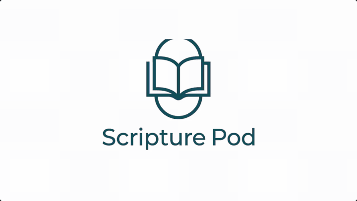
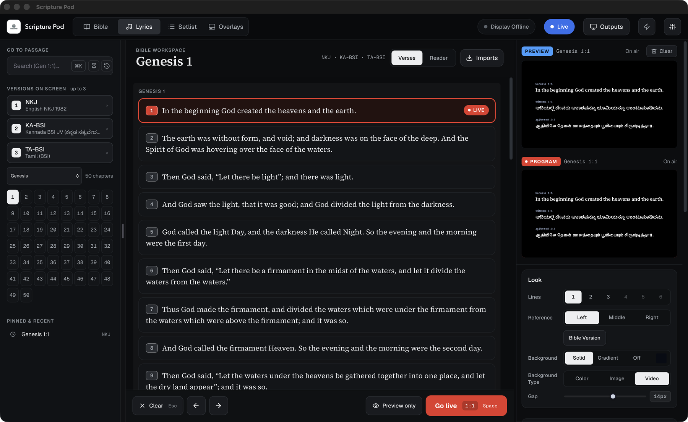
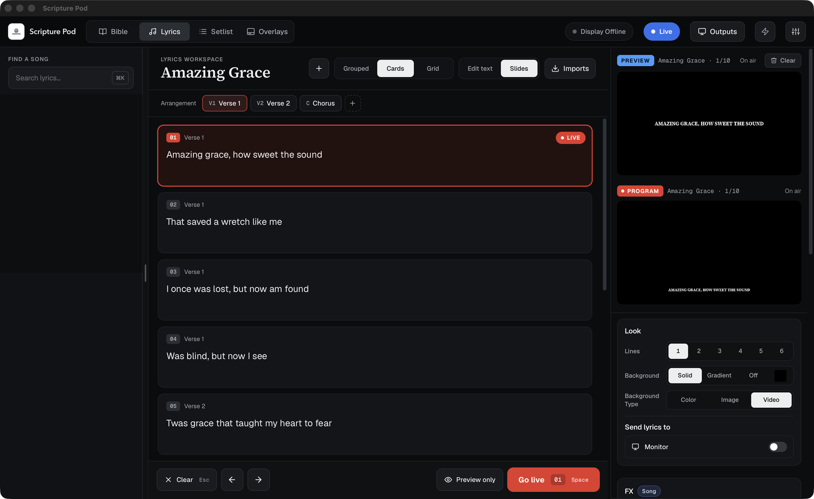
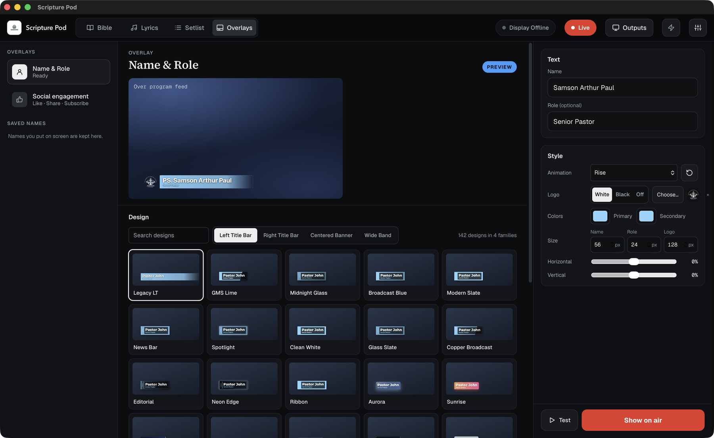

# Scripture Pod

Scripture Pod is a Bible and lyrics projection tool for churches. A control panel
sends verses, lyrics and lower thirds to an output window or to OBS. It is a
desktop app built with [Tauri](https://tauri.app) (Rust plus the system web view).
macOS, Windows and Linux are supported; the app is not built for Android or iOS.

## Demo



[Watch the demo as a video (MP4, 70 seconds)](docs/media/scripture-pod-demo.mp4)

## Screenshots

**Bible.** Up to three versions side by side, with Preview and Program monitors on the right.



**Lyrics.** Slides as cards, a grid or grouped, with arrangement chips.



**Overlays.** Name and role lower thirds with 140+ designs.



## Requirements

- [Rust](https://rustup.rs) (stable)
- Node.js 18 or newer and npm
- To package installers: the Tauri CLI, `cargo install tauri-cli --version "^2" --locked`
- Linux only: `libwebkit2gtk-4.1-dev libappindicator3-dev librsvg2-dev patchelf libxdo-dev`

## Run it

```bash
npm install
npm start
```

`npm start` runs the app from the project folder, so edits to `src/` show after a reload.

On first launch, choose the bundled Bibles in the setup dialog (English NKJV, Kannada and
Tamil BSI). They are imported once and stored on the computer.

You can also open `src/renderer/panel/panel.html` in a browser for quick UI work. Native
features (output windows, file dialogs, the display server) are unavailable there.

## Build an installer

```bash
npm run tauri:build
```

Installers are written to `src-tauri/target/release/bundle/` (`.app` and `.dmg` on macOS,
`.exe` on Windows, `.deb` and `.AppImage` on Linux). Build each system on that system.
The same builds run in GitHub Actions (`.github/workflows/push-release.yml`).

macOS apps are unsigned (no Apple Developer ID), so macOS blocks a downloaded copy. If it says
"Scripture Pod is damaged and can't be opened", the app is fine: macOS has only tagged the download
as quarantined. Drag it to Applications, then run this once in Terminal and open it again:

```bash
xattr -cr "/Applications/Scripture Pod.app"
```

If you see an "unidentified developer" warning instead, right-click the app and choose Open.

**Windows:** the installer is unsigned, so SmartScreen may show "Windows protected your PC". Choose
**More info**, then **Run anyway**. If the file was downloaded inside a zip and will not run, right-click
it, open **Properties**, tick **Unblock**, and try again.

**Linux:** nothing is blocked. For the `.AppImage`, make it executable once and run it:

```bash
chmod +x Scripture*.AppImage && ./Scripture*.AppImage
```

For the `.deb`, install it with `sudo apt install ./Scripture*.deb`.

CI builds on every push to `main` and publishes a pre-release with the installers
(`v<version>-build.<run number>`); pushing a `v*` tag publishes a normal release. The installers
are also kept as run artifacts for 14 days. One limit: GitHub will not let the workflow token tag a
commit that edits a file in `.github/workflows`, so such a push builds but publishes nothing.

## Output and OBS

- **Output window:** Outputs, then pick a screen. It is a transparent, frameless window
  that you capture in OBS with Window Capture or Display Capture.
- **Lyrics:** the live display always shows them as a lower third on a transparent page: the Stream
  feed, the Display link (OBS Browser Source) and the Program panel. Monitor feeds show them full
  screen with the clock: the main screen output window (HDMI or any external monitor) and the
  Monitor link (wireless). The Preview panel is full screen too. Bible verses follow the Look mode.
- **Monitor clock:** Outputs, Monitor clock shows the time on the main screen window and on every
  Monitor link (12 or 24 hour, any corner). The live display never shows it.
- **Stream feed:** a second, opaque output for a capture card, filled with a key colour
  (black for Luma Key, green for Chroma Key).
- **Browser source:** the app serves the display page on your network. In OBS add a Browser
  Source with the URL from **Settings, Host Mode, LAN Display URL**.

### Show the display on any laptop (no install)

The other laptop only needs a browser. In **Outputs**, **Any laptop with a browser**:

1. Choose **Show as**: Live display (lower third, transparent) or Monitor (full screen, clock).
2. Press **Scan network for laptops** and press **Use this laptop** next to the one you want.
3. On that laptop open the address shown, for example `http://192.168.1.20:8087/display.html`
   (`/monitor.html` opens it as a Monitor). The display starts by itself.

A laptop that opens the address without being picked waits on a "Waiting to be allowed" page, and
**Allow** / **Deny** buttons appear in Outputs (the Outputs button shows a dot). **Disconnect** or **Stop**
ends it. Only laptops you allow can connect, and only to the display. Port `8087` (and `5510`, `5511`)
must be allowed through the firewall, and both laptops must be on the same network.

### Show the display on another Scripture Pod computer

Open **Outputs**, **Other computers**. Computers on the same network that run Scripture Pod are
listed. On the other computer, switch on **Receive** (Outputs, Other computers) and read its pairing
code. Back on the controlling computer, type that code, pick **Live display** or **Monitor**, and press
**Connect**: the other computer opens this computer's display page full screen. **Disconnect**, or
**Stop showing the display here** on the other computer, closes it. Receive is off until you switch it
on, the code changes on every launch, and only this computer's own display page can be opened.
Computers find each other with small broadcasts on UDP port `5530`; allow it, `5510` and `5511`
through the firewall. Guest Wi-Fi or router "client isolation" blocks the broadcasts.

### Display on another computer

1. In **Settings, Host Mode**, choose **WebSocket Relay**.
2. Copy the **LAN Display URL** and open it on the other computer, or paste it into an OBS
   Browser Source.

The app prints the URL at startup. It uses this computer's LAN address, so it changes when you
join another network. Allow TCP ports `5510` (display page) and `5511` (relay) through the
firewall, and never expose them to the internet. If a port is busy the app uses the next free
one (set `SCRIPTURE_POD_HTTP_PORT` and `SCRIPTURE_POD_RELAY_PORT` to choose your own).

Links contain a per-launch access token. Treat them like passwords and re-copy them after a
restart. RemoteShow QR codes are generated on the computer and never sent to a QR service.
This is a browser display, not an NDI stream.

## Everyday tools

- **Stage display.** Outputs, **Stage display** opens a full-screen window for the worship team with the
  words on screen now, the next slide and the time. Any laptop can show it too: pick **Stage display** under
  **Show as** in **Any laptop with a browser**.
- **Phone remote.** Outputs, **Phone remote**: switch it on and scan the code with a phone on the same
  network. The phone gets Next, Previous, Go live, Clear and Preview, and shows what is on screen. Anyone
  with the link can control the service, so switch it off when you are done.
- **Shortcuts and clicker.** Settings, **Shortcuts**: add your own keys for the main actions. A presentation
  clicker works as it is: Page Down and Page Up move through slides, "." or B clears the screen.
- **Service templates.** In the Setlist, **Save as template** keeps the current setlist; **Start from a
  template** begins next week's from it.
- **Automatic backups.** Settings, General: choose a folder (Dropbox, Drive or OneDrive gives an off-computer
  copy), how often, and how many to keep. **Back up now** runs one at once.
- **Update notice.** The app looks for a newer release once a day (and on **Check for updates** in Settings)
  and offers its download page. It does not install updates by itself: that needs signed builds.

## Backup and restore

Use **Export Backup** and **Import Backup** in Settings (Import Backup is also on the
first-run screen). One JSON file holds:

- all songs, with translations
- every imported Bible version (the bundled ones too)
- the schedule and presets
- every setting: Look defaults, fonts, backgrounds (including uploaded images and videos), lower
  third styles and colours, host and output settings
- saved names, pinned and recent references, panel sizes, language and theme

Restoring replaces what is on this computer, asks first, and restarts the panel so everything
loads from the restored data. The Bible search index is rebuilt on the next start.

To move to a new computer or a fresh install: export on the old one, install, then choose
Import Backup on the first-run screen. The backup is verified end to end on a clean install
(songs, all three Bibles, schedule, presets, settings, saved names and layout come back
identical, and Bible search works again after the rebuild).

Not in the backup: the live display address and access token (new each launch), the
pairing code (regenerated), and window positions.

## Project layout

```
src/
  renderer/
    panel/       The control panel
      panel.html
      styles/    base.css, modern.css, console.css (loaded in that order)
      scripts/   Classic scripts loaded in order by panel.html, grouped by role:
        core/          state and storage, app core, settings, i18n and theme, startup
        library/       Bible and lyrics library, chapter grid, Bible search
        ui/            workspace, sidebar, shortcuts, command palette, app chrome
        output/        live output, sync, embedded Program/Preview displays
        sources/       media and backgrounds
        integrations/  host mode, translation, remote display tools
    display/     The output page (display.html, display.css), used by every output
    fonts/       Bundled fonts (Geist, Geist Mono, Source Serif 4)
  shared/        Code used by both pages: lower-third-extra.js (name designs),
                 social-overlay.js (social engagement lower third)
src-tauri/       The desktop app (Rust): servers, relay, Bible search, windows
assets/          bibles/ (bundled Bible XML), logo/, bg/
build/           App icon source and logo
test/            Node tests (`npm test` also runs the Rust tests)
.github/         CI: tests, installers, releases
```

See `src-tauri/README.md` for how the Rust side maps to the pages and what has been verified.

The display page is served at `/src/renderer/display/display.html`. The old
`/UI/scripture-pod-display.html` address redirects there, so saved OBS browser sources keep working.

## Tests

```bash
npm test
```

Runs the Node tests (lower-third designs, social overlay) and the Rust tests (relay token,
file serving rules, Bible search).

## Troubleshooting

- `cargo: command not found`: run `source "$HOME/.cargo/env"` or open a new terminal.
- The app window does not appear: run `npm start` and read the terminal for errors.
- Another copy holds the ports: the app moves to the next free ports, so the OBS URL changes.
  Quit the other copy to keep the same URL.
- The remote display does not load: both computers must be on the same network; re-copy the
  LAN URL and allow TCP `5510` and `5511` through the firewall.

## Contributing

Fork, make changes, and open a pull request. Keep changes focused and include short tests or
manual verification steps.
